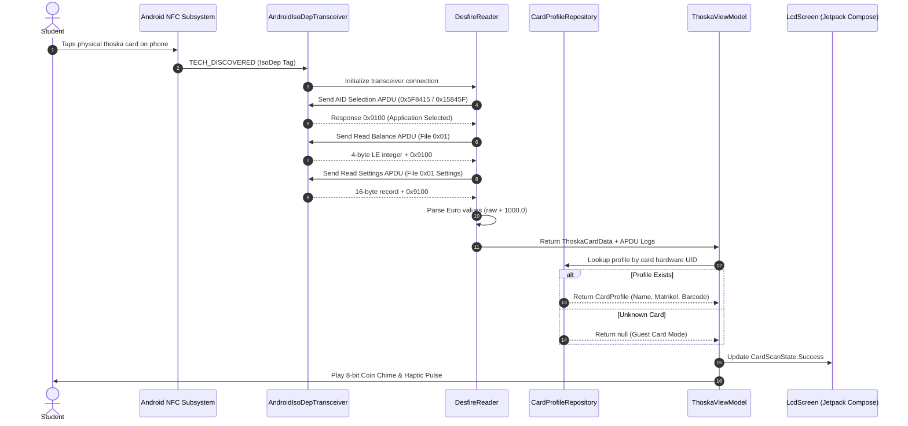

# 🎮 THOSKA BOY (ThoskaPulse)
### The 1990s Handheld Console Edition for Thüringen University Smartcards

[-3DDC84?style=for-the-badge&logo=android&logoColor=white)](https://developer.android.com)
[](https://kotlinlang.org)
[](https://developer.android.com/jetpack/compose)
[-F58220?style=for-the-badge&logo=nfc&logoColor=white)](https://en.wikipedia.org/wiki/ISO/IEC_14443)
[](#-security-privacy--offline-guarantee)
[](LICENSE)

**THOSKA BOY** transforms everyday university Mensa card balance inquiries into a tactile, nostalgic 1990s handheld gaming experience. Built with **Kotlin** and **Jetpack Compose**, it communicates directly with physical **MIFARE DESFire EV1 (thoska)** smartcards using raw ISO 7816-4 APDUs over **ISO-DEP** (NFC Type A), rendering live student balances, meal history, and digital library passes on an authentic olive-green dot-matrix LCD screen.

---

## 📸 Visual Design & Console Aesthetic

THOSKA BOY recreates the physical feel of a vintage handheld console matching the university colorway:

```
+-----------------------------------------------------------+
| (•) EAH JENA                                THOSKA BOY™   |
| +-------------------------------------------------------+ |
| | [BATTERY]              DOT MATRIX WITH STEREO SOUND   | |
| | +---------------------------------------------------+ | |
| | | THOSKA BOY OS v1.0                                | | |
| | |                                                   | | |
| | |           >> INSERT THOSKA CARTRIDGE <<           | | |
| | |                                                   | | |
| | |                                                   | | |
| | +---------------------------------------------------+ | |
| +-------------------------------------------------------+ |
|                                                           |
|       ▲                                                   |
|   ◀   ●   ▶                     ( B ) [HISTORY]           |
|       ▼                            ( A ) [FLIP CARD]      |
|                                                           |
|               [SELECT]     [START]                        |
|               [ EJECT]     [  TAP]                        |
|                                                           |
| STATUS: WAITING FOR NFC...               /// SPEAKER      |
| SLOT: EMPTY                              /// GRILLE       |
+-----------------------------------------------------------+
```

### 1. Handheld Casing & Colorway
* **Thoska Burnt Orange (`#E05A2B`) Shell**: Matte-textured casing with beveled outer boundaries, recessed screw indentations, and diagonal speaker grille slots (`///`).
* **EAH Jena Slate Teal (`#005A5B`) Bezel**: Thick inner screen frame with 3D bevels, power status LED, and `"DOT MATRIX WITH STEREO SOUND"` debossed lettering.
* **Debossed Branding**: `THOSKA BOY™` header in bold retro typography alongside a 3D-shaded EAH Jena pixel pyramid logo.
* **Dynamic Status Footer**:
  * **Idle Mode**: Displays neutral hardware diagnostic strings: `STATUS: WAITING FOR NFC...` and `SLOT: EMPTY`. Zero hardcoded student details!
  * **Card Loaded**: Dynamically displays cardholder name, student ID, and semester validity period (e.g. `VALID: 01.10.26 - 31.03.27`).

### 2. Vintage Olive-Green Dot-Matrix LCD (`#9BBC0F`)
* **Ultra-High Contrast Pixel Ink**: Text and block graphics are rendered in deep pixel-green (`#0A280A`) using `FontFamily.Monospace` with `FontWeight.Bold` for instant outdoor sunlight legibility.
* **Balance Digits**: Large, chunky numbers formatted according to German currency standards (e.g. **`40,40 €`**).
* **Meal Cost & HP Bar**: Shows the last meal cost deduction (`🍽 LAST MEAL: -1,40 €`) accompanied by a 10-segment pixel battery HP bar (`[■■■■■■■■□□]`) and estimated prior balance.

### 3. Tactile Controls & Labels
All buttons feature **large, bold, high-contrast dark-charcoal/black text (`#0F1115`)** rendered directly on/beside the controls:
* **Matte-Grey Directional Pad (`#3A3D42`)**: Directional arms with center indent circle and tactile audio click feedback.
* **Button A (`A [FLIP CARD]`)**:
  * If idle: displays a bold warning banner: `>> ATTENTION: NO CARD LOCKED - TAP THOSKA FIRST <<`.
  * If active: flips the card to reveal the **Back Pass View** with a high-contrast Code 39 barcode canvas, student identity, or guest registration dialog.
* **Button B (`B [HISTORY]`)**: Toggles an 8-bit RPG inventory-style transaction log overlay displaying up to the last 5 scans with timestamps, balances, and meal cost deltas.
* **SELECT (`SELECT [EJECT]`)**: Clears the active card from memory, resets displayed data, and returns the console immediately to the blank `"SLOT: EMPTY"` idle state.
* **START (`START [TAP]`)**: Simulates an instant NFC card tap event for testing and demonstrations without requiring a physical card present.

### 4. 8-Bit Audio & Haptic Feedback
* **ToneGenerator Chime**: Uses Android's low-latency native `ToneGenerator` to synthesize a classic 2-tone coin pickup chime (B5 → E6) upon successful card reading.
* **Haptic Vibration**: Hardware vibrator pulses on card lock and tactile button clicks.

---

## 🎛 App Icon: Custom "Retro Cartridge"

The application includes a custom 8-bit **Game Boy Cartridge launcher icon**:
* **Body**: Charcoal-grey plastic cartridge with authentic 45° top-right chamfer notch, thumb grip indentation, and lateral ridges.
* **Label Sticker**: Glossy Thoska Burnt Orange (`#E05A2B`) label with specular sheen, Slate Teal 3D pyramid logo, and bold pixel `"THOSKA"` typography.
* **Connector Pins**: Dual metallic gold contact pins (`#EBB923` / `#FFE16E`) exposed at the bottom PCB opening.
* **Adaptive Android Icon (API 26+)**: Configured with a 72dp safe-zone boundary so that circular, squircle, or rounded-rect launcher masks on modern Android skins (e.g., MagicOS, One UI, Pixel Launcher) never clip the cartridge geometry or pins.

---

## ⚡ Technical Architecture: NFC & MIFARE DESFire

Most university campuses in Thüringen (Studierendenwerk Thüringen) issue **thoska** cards built on **NXP MIFARE DESFire EV1** smartcards. These cards **do NOT contain standard NDEF records**, meaning standard Android NDEF NFC APIs will fail.

THOSKA BOY bypasses NDEF entirely, communicating directly with the card via **raw ISO-DEP (`IsoDep`, ISO 14443-4 Type A)** using low-level ISO 7816-4 APDU commands.



### APDU Protocol Specification

| Operation | Command APDU (Hex) | Description | Response Parsing |
| :--- | :--- | :--- | :--- |
| **Select AID** | `90 5A 00 00 03 5F 84 15 00` | Selects Mensa Application `5F 84 15` (falls back to reversed `15 84 5F`) | Status Word `91 00` (Success) |
| **Read Balance** | `90 6C 00 00 01 01 00` | Reads 4 bytes from Value File `0x01` | Little-endian 32-bit integer: $\text{Balance} = \frac{\text{raw}}{1000.0} \text{ EUR}$ |
| **Read Last Transaction** | `90 F5 00 00 01 01 00` | Reads 16-byte file settings / last transaction from File `0x01` | Bytes 12..15 as little-endian 32-bit int: $\text{Meal} = \frac{\text{raw}}{1000.0} \text{ EUR}$ |

---

## 👤 Dynamic Hardware UID Profiles (Privacy-First)

The app boots with **zero pre-seeded student data**. When a card is scanned:

1. **Hardware UID Binding**: The card's unique hardware identifier (`tag.id`, e.g., `04:31:56:CA:6C:24:90`) is read and normalized.
2. **Local Profile Lookup**: [CardProfileRepository.kt](file:///c:/Users/Hamim/thoska-reader/app/src/main/kotlin/de/thoska/pulse/data/CardProfileRepository.kt) checks encrypted private local preferences:
   * **Registered Cards**: Dynamically loads the student's saved Name, Matrikel number, Validity, and renders their 12-digit Code 39 Library Barcode on the Button A flip screen.
   * **Guest Cards**: Displays live Mensa Balance and Last Meal Cost alongside `"GUEST CARD [UID]"`. Pressing **Button A** displays a retro `[ + REGISTER THIS CARD ]` button allowing that individual to input their student details and bind them locally to their card's UID.
3. **Eject Action**: Pressing **SELECT** immediately purges the active profile from memory and returns the console to the blank cartridge slot.

---

## 📂 Project Structure

```
thoska-reader/
├── app/
│   ├── src/
│   │   ├── main/
│   │   │   ├── AndroidManifest.xml
│   │   │   ├── kotlin/de/thoska/pulse/
│   │   │   │   ├── MainActivity.kt               # NFC Lifecycle, foreground dispatch
│   │   │   │   ├── data/
│   │   │   │   │   ├── CardProfileRepository.kt  # Dynamic UID-to-student profile DB
│   │   │   │   │   └── ScanHistoryRepository.kt  # SQLite scan history storage
│   │   │   │   ├── model/
│   │   │   │   │   ├── CardProfile.kt            # Student profile data class
│   │   │   │   │   ├── ThoskaCardData.kt         # Live card data & formatted currency
│   │   │   │   │   ├── ScanRecord.kt             # Historical scan log entry
│   │   │   │   │   └── ApduLogEntry.kt           # Raw APDU command/response trace
│   │   │   │   ├── nfc/
│   │   │   │   │   ├── IsoDepTransceiver.kt      # Abstract transceiver interface
│   │   │   │   │   ├── AndroidIsoDepTransceiver.kt # Android NFC IsoDep wrapper
│   │   │   │   │   ├── DesfireReader.kt          # MIFARE DESFire protocol implementation
│   │   │   │   │   └── DesfireApduParser.kt      # APDU byte array parser & currency math
│   │   │   │   ├── ui/
│   │   │   │   │   ├── screens/
│   │   │   │   │   │   ├── DashboardScreen.kt    # Main console layout
│   │   │   │   │   │   └── components/
│   │   │   │   │   │       ├── LcdScreen.kt      # Olive-green LCD (Front/Back/History)
│   │   │   │   │   │       ├── TactileControls.kt# 3D D-Pad, Glossy A/B, Select/Start
│   │   │   │   │   │       ├── ConsoleShellDetails.kt # EAH Jena branding, speaker grille
│   │   │   │   │   │       └── RegisterCardDialog.kt # Retro guest registration dialog
│   │   │   │   │   ├── theme/
│   │   │   │   │   │   ├── Color.kt              # Burnt Orange, Slate Teal, Olive LCD
│   │   │   │   │   │   ├── Theme.kt              # Compose Material 3 theme mapping
│   │   │   │   │   │   └── Type.kt               # Bold Monospace typography
│   │   │   │   │   └── viewmodel/
│   │   │   │   │       └── ThoskaViewModel.kt    # StateFlow management & business logic
│   │   │   │   └── util/
│   │   │   │       └── RetroSoundAndHaptics.kt   # ToneGenerator coin chime & vibrator
│   │   │   └── res/
│   │   │       ├── drawable/                     # Adaptive icon background & vector assets
│   │   │       ├── mipmap-anydpi-v26/            # Adaptive launcher icon XMLs
│   │   │       ├── mipmap-[mdpi...xxxhdpi]/      # Custom Retro Cartridge PNG icons
│   │   │       ├── values/                       # Strings, theme styles
│   │   │       └── xml/                          # nfc_tech_filter.xml (IsoDep)
│   │   └── test/kotlin/de/thoska/pulse/
│   │       ├── DesfireApduParserTest.kt          # APDU parsing & currency unit tests
│   │       ├── DesfireReaderTest.kt              # Mock ISO-DEP transceiver test suite
│   │       └── CardProfileRepositoryTest.kt      # UID normalization & profile tests
├── build.gradle.kts
└── settings.gradle.kts
```

---

## 🔒 Security, Privacy & Offline Guarantee

* **100% Offline**: The app does **NOT** declare `android.permission.INTERNET`. Zero network communication, zero analytics, zero crash telemetry.
* **Read-Only NFC Operation**: All APDUs sent to the thoska smartcard are read-only (`Read Data`, `Get File Settings`). The app **cannot deduct funds, alter balances, or write to card sectors**.
* **Local Storage Only**: Scanned transaction histories and card profiles remain strictly on the local device inside private app storage.

---

## 🛠️ Building & Installation

### Prerequisites
* **Android Studio** Hedgehog / Iguana / Ladybug or newer
* **Java Development Kit (JDK)**: OpenJDK 17 or 21
* **Android SDK**: Compile SDK `34`, Min SDK `26` (Android 8.0 Oreo)

### Running Unit Tests
Execute the test suite with plain console output:
```bash
./gradlew test --no-daemon --console=plain
```
*Tests cover APDU byte parsing, little-endian division, reverse AID fallback, ISO-DEP error handling, and hardware UID normalization.*

### 📥 Download Pre-built APK
You can download and install the latest pre-compiled debug APK directly from this repository:
👉 **[Download THOSKA BOY APK (release/thoska-boy-debug.apk)](release/thoska-boy-debug.apk)** (~16.1 MB)

### Building the Debug APK
```bash
./gradlew assembleDebug --no-daemon --console=plain
```
The compiled APK will be located at:
`app/build/outputs/apk/debug/app-debug.apk` and `release/thoska-boy-debug.apk`

### Installing to Connected Device via ADB
Ensure USB or Wireless Debugging is enabled on your Android phone, then run:
```bash
./gradlew installDebug --no-daemon --console=plain
```

---

## 🎓 Compatible University Cards (thoska)

THOSKA BOY is compatible with standard Thüringen Mensa smartcards across all universities affiliated with Studierendenwerk Thüringen:
* **EAH Jena** (Ernst-Abbe-Hochschule Jena)
* **FSU Jena** (Friedrich-Schiller-Universität Jena)
* **Bauhaus-Universität Weimar**
* **TU Ilmenau** (Technische Universität Ilmenau)
* **Universität Erfurt**
* **Hochschule Nordhausen**
* **Hochschule Schmalkalden**
* **Musikhochschule Franz Liszt Weimar**

---

## 📜 License

This project is licensed under the **MIT License** — see the [LICENSE](LICENSE) file for details.

*Disclaimer: "thoska" is a trademark of the Thüringer Hochschulen. THOSKA BOY is an independent open-source student hobby project and is not officially affiliated with or endorsed by Studierendenwerk Thüringen or EAH Jena.*
