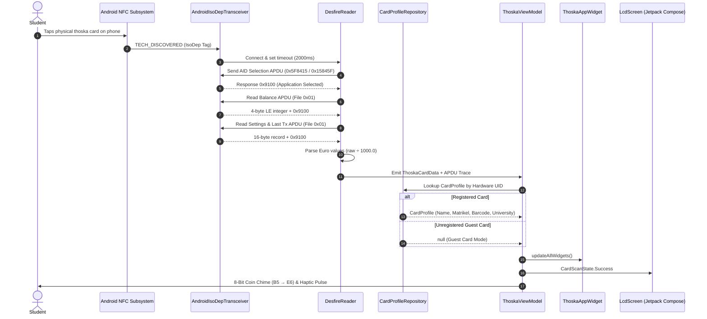

# 🎮 THOSKA BOY (ThoskaPulse)
### The 1990s Handheld Console Edition for Thüringen University Smartcards

[-3DDC84?style=for-the-badge&logo=android&logoColor=white)](https://developer.android.com)
[-F58220?style=for-the-badge&logo=googleplay&logoColor=white)](release/thoska-boy-v1.1.0.apk)
[-1976D2?style=for-the-badge&logo=fdroid&logoColor=white)](#-f-droid-packaging--submission-guide)
[](https://kotlinlang.org)
[](https://developer.android.com/jetpack/compose)
[-E05A2B?style=for-the-badge&logo=nfc&logoColor=white)](https://en.wikipedia.org/wiki/ISO/IEC_14443)
[-0A280A?style=for-the-badge&logo=shield&logoColor=white)](#-security-privacy--offline-guarantee)
[](LICENSE)

**THOSKA BOY** transforms everyday university Mensa card balance inquiries into a tactile, nostalgic 1990s handheld gaming experience. Built with **Kotlin** and **Jetpack Compose**, it communicates directly with physical **MIFARE DESFire EV1 (thoska)** smartcards using raw ISO 7816-4 APDUs over **ISO-DEP** (NFC Type A), rendering live student balances, meal history, and digital library passes on an authentic dot-matrix LCD screen with selectable retro palettes.

> [!IMPORTANT]
> **100% Offline & Zero Permissions**: THOSKA BOY has **zero internet permissions** (`android.permission.INTERNET` is completely omitted). No analytics, no telemetry, no tracking, and zero hardcoded student data. All identity profiles and scan logs reside strictly in private on-device storage.

---

## 🕹️ Interactive Handheld Console Overview

```
+-----------------------------------------------------------+
| [■] THOSKA SYSTEM                           THOSKA BOY™   |
| +-------------------------------------------------------+ |
| | [BATTERY]              DOT MATRIX WITH STEREO SOUND   | |
| | +---------------------------------------------------+ | |
| | | THOSKA BOY OS v1.0                     CHIP:LOCKED| | |
| | |                                                   | | |
| | |             CASH OUT / BAL                        | | |
| | |                40,40 €                            | | |
| | |             🍽 LAST: -1,40 €                      | | |
| | |          [■■■■■■■■□□] (HP 80%)                    | | |
| | |    >> AFFORDS: 28x COFFEE (AT 1,40 €) <<          | | |
| | | A:FLIP                 B:LOG             START:TAP| | |
| | +---------------------------------------------------+ | |
| +-------------------------------------------------------+ |
|                                                           |
|       ▲ (BUDGET -)                                        |
|   ◀ (THEME) ▶ (THEME)               ( B ) [HISTORY]       |
|       ▼ (BUDGET +)                     ( A ) [FLIP CARD]  |
|                                                           |
|               [SELECT]     [START]                        |
|               [ EJECT]     [  TAP]                        |
|                                                           |
| VALID: 01.10.26 - 31.03.27               /// SPEAKER      |
| MAX MUSTERMANN | ID: 1234567             /// GRILLE       |
+-----------------------------------------------------------+
```

---

## ✨ Features & Version 1.1.0 Expansion

### 1. 🏛️ Universal Thuringian Universities Support (10 Institutions)
THOSKA BOY includes an embedded catalogue and dedicated 8-bit Canvas vector emblems for all 10 higher education institutions across Thuringia that issue the thoska card:

| Institution | Short Name | Canvas Badge Signature | Colorway |
| :--- | :--- | :--- | :--- |
| **Ernst-Abbe-Hochschule Jena** | `EAH JENA` | Geometric stacked triangle pyramid | Teal (`#005A5B`) |
| **Friedrich-Schiller-Universität Jena** | `FSU JENA` | Academic seal silhouette & gold star crest | Deep Blue (`#002F5D`) |
| **Technische Universität Ilmenau** | `TU ILMENAU` | 8-tooth technical gear & orbiting atom | Pine Green (`#006633`) |
| **Bauhaus-Universität Weimar** | `BAUHAUS WEIMAR` | Constructivist square, circle & triangle | Bauhaus Red (`#E3000B`) |
| **Universität Erfurt** | `UNI ERFURT` | Twin Gothic cathedral spires & open book | Crimson (`#A51E37`) |
| **Fachhochschule Erfurt** | `FH ERFURT` | Classical 3-pillar architectural temple | Green (`#00854A`) |
| **Hochschule Schmalkalden** | `HS SCHMALKALDEN` | Stepped heraldic diagonal shield | Cyan (`#005478`) |
| **Hochschule Nordhausen** | `HS NORDHAUSEN` | 4-quadrant diamond modern tech grid | Royal Blue (`#004B93`) |
| **HfM Franz Liszt Weimar** | `HFM WEIMAR` | 8-bit classical lyre harp with strings | Wine Red (`#8B0000`) |
| **Duale Hochschule Gera-Eisenach** | `DHGE` | Interlocking dual-campus square links | Navy (`#003366`) |

* **Dynamic Header Rendering**: When a registered card is locked, the console casing header displays that university's custom 8-bit emblem and title.
* **Neutral "THOSKA SYSTEM" State**: When no card is active (idle "NO CARTRIDGE" state) or an unregistered guest card is tapped, the console displays a neutral retro 8-bit cartridge/chip emblem with the debossed label **"THOSKA SYSTEM"**.

### 2. 🎛️ Interactive D-Pad Controls
The matte-grey 4-way Directional Pad features physical haptic click feedback:
* **D-Pad UP / DOWN (Mensa Budget Simulator)**:
  Cycles through 4 standard Studierendenwerk Thüringen meal & campus amenities presets:
  1. `COFFEE / ESPRESSO (1.40 €)`
  2. `WASHING MACHINE (2.00 €)`
  3. `CLASSIC MENSA DISH (2.60 €)`
  4. `PREMIUM MENSA MEAL (3.80 €)`
  
  Calculates instant purchasing power on the LCD (e.g. `>> AFFORDS: 28x COFFEE (AT 1,40 €) <<`).
* **D-Pad LEFT / RIGHT (LCD Theme Switcher)**:
  Toggles between 3 authentic vintage display palettes (persisted across sessions in local preferences):
  1. **DMG OLIVE**: Classic Game Boy olive-green background (`#9BBC0F`) with ultra-dark pixel ink (`#0A280A`).
  2. **POCKET SILVER**: High-contrast silver-grey background (`#C4CFA1`) with slate ink (`#181C18`).
  3. **BACKLIT CYAN**: Night-mode glowing cyan background (`#00E5FF`) with dark midnight ink (`#001F24`).

### 3. 🔦 Max-Brightness Auto-Boost for Library Passes
* Pressing **Button A (`[FLIP CARD]`)** flips to the barcode screen. If a student library barcode is configured, a Compose `DisposableEffect` temporarily overrides the display brightness to **100% (`1.0f`)** so optical laser/CCD scanners at self-checkout library terminals can scan the screen effortlessly.
* Features a pure white (`#FFFFFF`) quiet-zone padding box and a `[MAX BRIGHTNESS ACTIVE]` indicator.
* Screen brightness immediately resets to system defaults when flipping back or pressing `SELECT [EJECT]`.

### 4. 🚨 Low-Balance ("Low HP") & Semester Validation Expiry Alerts
* **Low Credits Warning**: If the card balance drops below **5.00 €**, the LCD screen flashes a bold alert: `! LOW CREDITS - VISIT AUFWERTER !`, accompanied by a rapid 3-beep low-health tone generated via native `ToneGenerator`.
* **Semester Validation Alert**: The parser inspects the semester validity string (`validUntil`). If the card is expired or within 14 days of expiration, a bold warning appears: `! VALIDATE CARD AT TERMINAL !`.

### 5. 💾 Offline CSV History Export (Button B)
* Inside the **Button B (`[HISTORY]`)** screen, tap **`[ EXPORT CSV ]`** to export recorded scans.
* Uses Android's native **Storage Access Framework (`ActivityResultContracts.CreateDocument("text/csv")`)** with pre-filled filename `thoska_history.csv`.
* Requires **zero storage permissions** (`READ_EXTERNAL_STORAGE` / `WRITE_EXTERNAL_STORAGE` not needed).

### 6. 📱 Android Home Screen Mini-Widget ("Thoska Cartridge Widget")
* Includes a lightweight native 3x1 `AppWidgetProvider` (`ThoskaAppWidget`).
* Styled like a mini olive-green dot-matrix cartridge showing:
  * Last scanned balance (e.g., `LAST BAL: 40.40 €`)
  * Last meal deduction (e.g., `MEAL: -1.40 €`)
  * Scan timestamp
* Automatically updates whenever a new NFC scan occurs, with a one-tap `PendingIntent` launching the console directly.

---

## ⚡ Technical Architecture: Low-Level NFC & MIFARE DESFire

Most student smartcards in Thuringia use **NXP MIFARE DESFire EV1** architecture. These cards **do not contain standard NDEF records**, rendering standard Android NDEF reader implementations non-functional.

THOSKA BOY communicates directly using **ISO-DEP (`IsoDep`, ISO 14443-4 Type A)**, transmitting raw ISO 7816-4 APDU commands:



### APDU Protocol Specification

| Step | Operation | Command APDU (Hex) | Description | Response Parsing |
| :--- | :--- | :--- | :--- | :--- |
| **01** | **Select AID** | `90 5A 00 00 03 5F 84 15 00` | Selects Mensa Application `5F 84 15` (falls back to `15 84 5F`) | Status Word `91 00` |
| **02** | **Read Balance** | `90 6C 00 00 01 01 00` | Reads 4-byte value from Value File `0x01` | Little-endian 32-bit int: $\text{Balance} = \frac{\text{raw}}{1000.0} \text{ EUR}$ |
| **03** | **Read Last Tx** | `90 F5 00 00 01 01 00` | Reads 16-byte file settings / last transaction from File `0x01` | Bytes 12..15 as LE 32-bit int: $\text{Meal} = \frac{\text{raw}}{1000.0} \text{ EUR}$ |

---

## 🔒 Security, Privacy & Offline Guarantee

* **100% Offline (No Internet Permission)**: The application does **not** include `android.permission.INTERNET` in its manifest. It cannot make network calls, send telemetry, or contact remote servers.
* **Read-Only NFC Operation**: All APDU commands sent to the thoska card are strictly read-only (`Read Data`, `Get File Settings`). The app cannot deduct credits, write sectors, or modify card parameters.
* **Private Local Storage**: Transaction history and optional student profiles are stored exclusively in private on-device app storage.
* **Eject / Instant Memory Clear**: Pressing the physical **`SELECT [EJECT]`** button immediately purges the active card, profile, and APDU logs from active memory.

---

## 📦 F-Droid Packaging & Submission Guide

THOSKA BOY is built from the ground up to comply with **F-Droid Inclusion Guidelines** and the **Free Software Definition**:

### F-Droid Compliance Checklist
- [x] **100% Free and Open Source (FSDG compliant)**: MIT Licensed.
- [x] **No Non-Free Dependencies**: No proprietary Google Play Services, Firebase, or closed-source libraries.
- [x] **Zero Anti-Features**:
  - `NoTracking`: No analytics or user telemetry.
  - `NoAds`: No advertising frameworks.
  - `NoNonFreeNet`: Zero network connectivity required.
- [x] **Fastlane Metadata Included**: Full structure in `fastlane/metadata/android/en-US/`.
- [x] **Reproducible Builds**: Standard Gradle build pipeline.

### Fastlane Metadata Directory Structure
```
fastlane/metadata/android/en-US/
├── title.txt                  # "THOSKA BOY"
├── short_description.txt      # 1990s Handheld Console & Offline NFC Reader...
├── full_description.txt       # Comprehensive markdown feature summary
└── changelogs/
    └── 2.txt                  # VersionCode 2 (v1.1.0) release notes
```

### F-Droid Metadata Recipe Snippet (`de.thoska.pulse.yml`)
```yaml
Categories:
  - Utility
License: MIT
AuthorName: Hamim
SourceCode: https://github.com/username/thoska-reader
IssueTracker: https://github.com/username/thoska-reader/issues

AutoUpdateMode: Version
UpdateCheckMode: Tags

Builds:
  - versionName: 1.1.0
    versionCode: 2
    commit: v1.1.0
    subdir: app
    gradle:
      - yes
```

---

## 📥 Downloads

| Version | Release Artifact | Target Android | Architecture |
| :--- | :--- | :--- | :--- |
| **v1.1.0** *(Latest)* | [**thoska-boy-v1.1.0.apk**](release/thoska-boy-v1.1.0.apk) | Android 8.0 - 14+ (API 26-34) | Universal (`arm64-v8a`, `armeabi-v7a`, `x86_64`) |
| **Debug Build** | [**thoska-boy-debug.apk**](release/thoska-boy-debug.apk) | Android 8.0 - 14+ (API 26-34) | Universal |

---

## 🛠️ Build & Verification

### Prerequisites
* **Android SDK**: Compile SDK `34`, Min SDK `26` (Android 8.0 Oreo)
* **Java Development Kit**: JDK 17 (recommended: OpenJDK / Eclipse Temurin 17)

### 1. Execute Unit Test Suite
```bash
./gradlew testDebugUnitTest --no-daemon --console=plain
```
*Tests cover APDU parsing, little-endian arithmetic, all 10 university enum lookups, budget simulator calculations, validation expiry evaluations, and CSV serialization.*

### 2. Assemble Debug APK
```bash
./gradlew assembleDebug --no-daemon --console=plain
```
Output artifact: `app/build/outputs/apk/debug/app-debug.apk`

### 3. Install on Connected Device
```bash
adb install -r release/thoska-boy-v1.1.0.apk
```

---

## 📜 License

Distributed under the **MIT License**. See [`LICENSE`](LICENSE) for full details.

*Disclaimer: "thoska" is a registered trademark of the Thüringer Hochschulen. THOSKA BOY is an independent, privacy-first open-source student hobby project and is not officially affiliated with or endorsed by Studierendenwerk Thüringen, EAH Jena, or participating institutions.*
